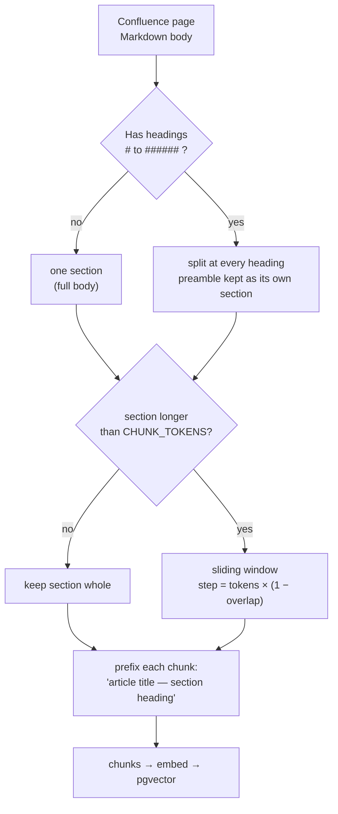

# Chunking method

How a Confluence page becomes a set of vectors, and why the split points are where they are.

Code: `backend/app/knowledge/chunker.py` · settings: `CHUNK_TOKENS`, `CHUNK_OVERLAP` ·
ingest: `backend/app/knowledge/ingest.py`

---

## 1. The problem chunking solves

An embedding covers a few hundred words well. Push a whole runbook through one, and the vector
becomes an average of every topic in it — precise for nothing, close to everything. Split it
too small and a step loses the sentence that says which system it applies to.

The target is a chunk that:

1. holds **one idea** (usually one section),
2. is **self-describing** when read alone (title + section heading),
3. is small enough that five of them fit the prompt with room to spare.

---

## 2. The algorithm



Three decisions, in order:

**a. Split on structure first.** `^(#{1,6})\s+(.+)$` finds Markdown headings. A runbook's
"Prerequisites" and "Rollback" are separate sections, so they become separate chunks even when
the page is short. The preamble before the first heading is kept as its own section — that is
usually the summary, and it is the most retrievable part of the page.

**b. Window only what is still too long.** A section over `CHUNK_TOKENS` (default **800**,
words as the token proxy) is cut with a step of `chunk_tokens × (1 − overlap)`. With the
default `0.10` overlap the step is 720 words: consecutive chunks share 80 words, which is
enough to keep a sentence that straddles the boundary readable in both.

**c. Prefix every chunk with its context.** Each chunk is emitted as
`"<page title> — <section heading>. <body>"`. This is the single highest-value line in the
chunker: without it, a chunk that says *"restart the pod and wait for Ready"* is unretrievable
for "how do I recover a crashlooping container", because the word *container* never appears.
With it, the title travels into the embedding and into the reranker input.

---

## 3. Worked example

A page titled **"Kubernetes & Cloud Workloads"** with three sections:

```markdown
## CrashLoopBackOff

Check events first. A pod that restarts with the same exit code is
usually a bad config or a missing secret.

## Pulling a private image

Create an imagePullSecret in the namespace and reference it in the pod spec.

## Rollback

kubectl rollout undo deployment/<name>
```

Produces four chunks (the preamble is empty here):

```
"Kubernetes & Cloud Workloads — CrashLoopBackOff. Check events first. A pod that restarts …"
"Kubernetes & Cloud Workloads — Pulling a private image. Create an imagePullSecret …"
"Kubernetes & Cloud Workloads — Rollback. kubectl rollout undo deployment/<name>"
```

Each is short, on-topic, and carries the words *Kubernetes* and the section name that a user
will type.

---

## 4. Why 800 tokens, 10% overlap

| Value | Effect at 400 | Effect at 1600 |
| --- | --- | --- |
| **800** | one procedure per chunk, five fit the prompt comfortably | a whole subsection per chunk; two or three topics averaged into one vector |
| overlap 10% | boundary sentences readable on both sides | 25% wastes ~1/5 of the index on duplicated text |

800 words ≈ 1,100–1,200 tokens of English, which is small enough for a 768-dimension embedding
to represent one idea and large enough that a numbered procedure survives intact. The numbers
are settings (`CHUNK_TOKENS`, `CHUNK_OVERLAP`), and changing them means **re-ingesting** —
existing vectors keep the old geometry until the pages are re-chunked.

---

## 5. Metadata stored with every chunk

Chunking alone is not enough; each vector carries the keys retrieval filters on:

| Key | Used for |
| --- | --- |
| `page_id` | dedupe, per-article cap, neighbour expansion |
| `chunk_index` | ordering neighbours, `±1` expansion of a winning article |
| `page_title` | the context prefix, and citation labels |
| `domain` | RBAC scoping and the classifier filter |
| `source_url` | the citation link back to Confluence |

`chunk_index` is what makes **neighbour expansion** possible: when one chunk wins, the pipeline
can fetch the chunks on either side of it from the same page, so the model sees a whole article
instead of a slice. Without the index stored, that feature silently does nothing — it did once,
and answers were short and narrow as a result.

---

## 6. Where chunking shows up in a bad answer

| Symptom | Likely chunking cause | Fix |
| --- | --- | --- |
| An answer quotes a step with no context ("restart it") | chunk lost its heading | confirm the prefix exists; re-ingest |
| Two unrelated procedures blended | section longer than 800 and no headings inside | add headings upstream, or lower `CHUNK_TOKENS` |
| A specific error string is never found | the string is in a table or a code block that the loader flattened | fix the loader/format, then re-ingest |
| Five citations, all the same article | chunking is fine — the per-article cap is doing its job; check retrieval instead | see [RAG-PIPELINE.md](RAG-PIPELINE.md) |

---

## 7. Rebuilding the index

```bash
# from the UI: Knowledge → Sync  (incremental: unchanged pages are skipped by content hash,
# changed pages are re-chunked after their old vectors are deleted, and pages deleted in
# Confluence are pruned — a sync that returns no pages prunes nothing, by design)
```

There is no separate CLI for a re-index: the sync endpoint is the only writer, and it is
idempotent, so a full rebuild means clearing the collection and pressing Sync.

A change to `CHUNK_TOKENS` or `CHUNK_OVERLAP` requires a full re-index: delete the collection
and sync, or the old and new chunk sizes coexist and skew the per-article cap. The embedding
model change is a bigger rebuild — see [EMBEDDINGS.md](EMBEDDINGS.md).
