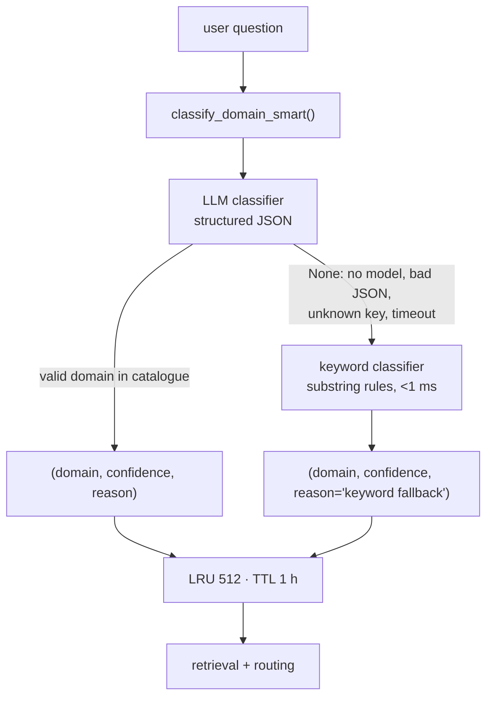
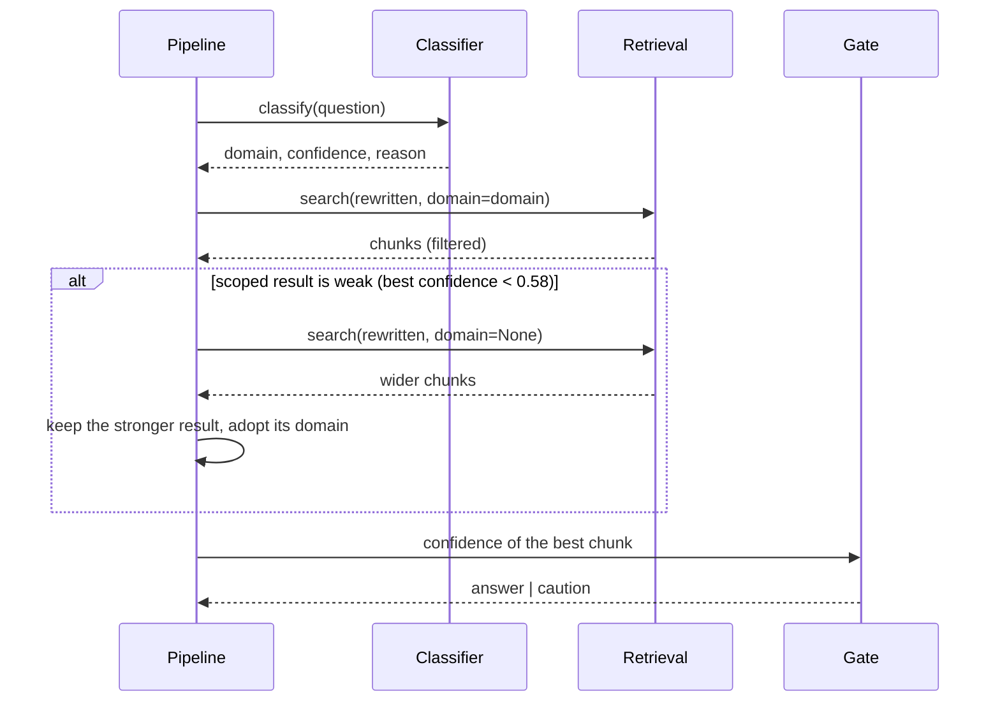
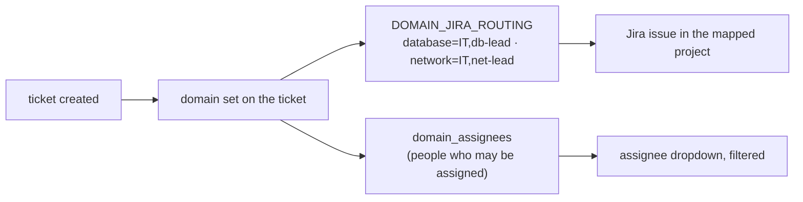

# Classification and domain routing

How the assistant decides *what kind of question* it is looking at, and what that decision
changes downstream.

Code: `backend/app/classifier/llm_classifier.py` (LLM path),
`backend/app/classifier/engine.py` (keyword fallback) · catalogue: `classifier_domains` table,
edited on **Knowledge → Domains**

---

## 1. Why classify at all

A single retrieval index mixing runbooks, network fixes and password resets produces middling
results for everything. The domain is a **filter and a router**:

| Consumer | Uses the domain for |
| --- | --- |
| retrieval | metadata filter on `cmetadata->>'domain'`, plus a soft retry when the scoped search looks weak |
| RBAC | a `user` may only read `general` + `system`; the filter is applied before ranking |
| tickets | `DOMAIN_JIRA_ROUTING` sends the issue to the right project/assignee |
| analytics | the Overview board's "knowledge by domain" and the classifier quality panel |

So a wrong domain is expensive: it narrows the search to the wrong shelf.

---

## 2. Two classifiers, one entry point



`classify_domain_smart()` **always returns a usable answer**. The LLM is the accurate path; the
keyword classifier is the guaranteed one. There is no branch where classification throws.

### The LLM path

The prompt is built at request time from the database, not from code:

```
Domains (key — what belongs here):
- general — General IT: anything not covered by a specific domain
- network — Network & VPN: DNS, Wi-Fi, firewall, connectivity
- database — Database: PostgreSQL, Oracle, locks, slow queries
…

Rules:
- Answer with JSON only, no prose.
- "domain" MUST be one of the keys above.
- If nothing fits well, use "general".
- "confidence" is 0..1 and must reflect genuine certainty: use a low value
  (<0.6) when the question is ambiguous or spans several domains.
- "reason" is one short sentence naming the words that drove the choice.
```

Three properties matter here:

1. **Adding a domain is a data change.** `display_name` and `description` are admin-editable, so
   a new domain appears in the prompt on the next call — no deploy.
2. **The model must answer inside the catalogue.** A key not present in `classifier_domains` is
   treated as a failure and the fallback runs; the model cannot invent a domain that no filter
   understands.
3. **Confidence is asked for explicitly**, and a low value is expected for ambiguous questions
   rather than a forced guess.

Results are cached in a bounded LRU (512 entries, 1 h TTL) because users repeat questions and
the same question should not cost a second model call.

### The keyword fallback

`engine.classify_domain()` is a weighted substring counter over admin-managed keywords:

| Rule | Weight |
| --- | --- |
| any hit in `security` | ×2 — a breach signal outranks a generic word |
| any hit in `kubernetes`, `storage`, `application` | ×1.5 — specific beats generic |
| confidence | `min(0.75 + 0.1 × (hits − 1), 0.98)` |
| no hit at all | `general`, confidence `0.3` |

Rules are cached in memory for 5 minutes and reloaded when an admin edits domains, so
classification stays sub-millisecond.

**Why the LLM path exists:** the keyword counter scores a single coincidental match at exactly
`0.75`, which *is* the "trust me" threshold. Live case: *"What is the SDLC engineering process
and what are the key stages?"* scored `server` at 0.75, filtered retrieval to `server`, and told
the user nothing was found — while the page sat under `general`. It is also blind to Burmese,
which the knowledge base contains.

---

## 3. What happens after classification



Two safety nets sit between the classifier and the answer:

**Soft domain filter.** If the scoped search returns nothing usable, the pipeline retries
without the filter and keeps whichever result is better (by distance). A misclassification then
costs a little latency, not an answer.

**Stage-2 override.** If the classifier was unsure (`< 0.7`) and documents were retrieved, the
top document's stored `domain` replaces the guess. The index already knows which domain a chunk
belongs to — that is a better signal than a guess from the question alone.

Neither net widens permissions: RBAC is applied by the caller, so an unrestricted retry still
cannot return a chunk the user may not read.

---

## 4. The other direction: routing a ticket

Classification also feeds the ticket workflow, where "which domain" means "who owns it":



- `DOMAIN_JIRA_ROUTING` is a setting: `database=IT,db-lead;network=IT,net-lead`.
- `domain_assignees` is edited on **Knowledge → Domains**; the ticket dialog only offers people
  mapped to that domain (the list narrows when the category changes).
- A domain with no assignee cannot route; the create dialog says so instead of failing at submit.

---

## 5. Tuning

| Want | Do |
| --- | --- |
| better routing on ambiguous questions | improve `description` on each domain — that text *is* the prompt |
| fewer wrong-domain searches | leave it alone; the soft filter already recovers, and lowering confidence only adds latency |
| a new domain | Knowledge → Domains → add, describe, assign people; re-index or **Reclassify** to re-tag existing chunks |
| classifier is slow | check LLM latency; the cache only helps repeats, first-time questions pay one call |
| classifier always falls back | LLM not configured or unreachable — `GET /api/setup/readiness` says which |

Re-tagging existing chunks: **Knowledge → Reclassify** runs the same classifier over stored
articles (`app/knowledge/reclassify.py`) and updates `cmetadata.domain`, so an improved domain
definition fixes old content as well as new questions.
