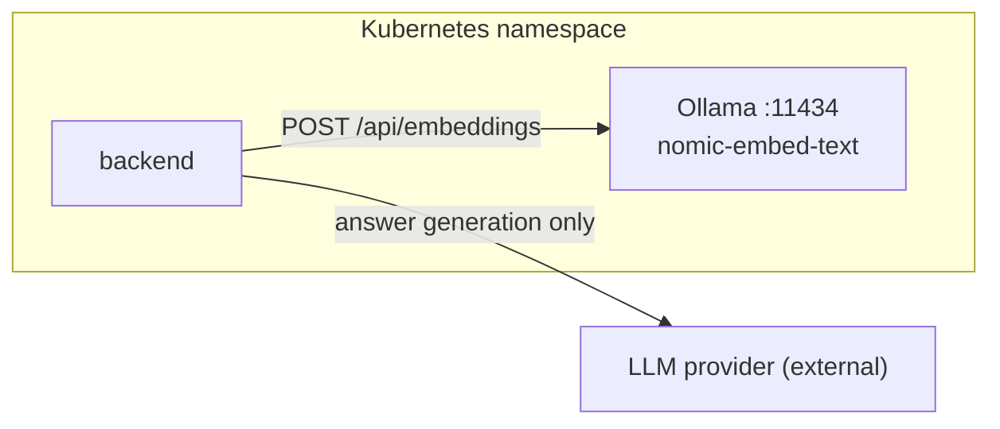
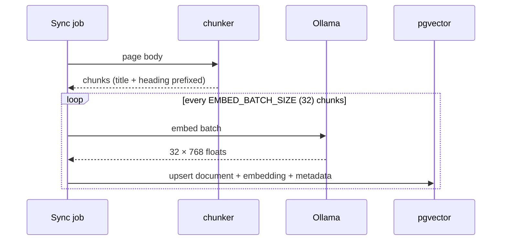

# Embeddings — Ollama + `nomic-embed-text`

How text becomes a 768-dimension vector, where that happens, and what breaks when you change it.

Code: `backend/app/rag/retrieval.py` (`get_embeddings`) · settings: `EMBEDDING_MODEL`,
`EMBEDDING_DIM`, `OLLAMA_URL`, `EMBED_BATCH_SIZE` · manifest: `infra/k8s-dev/41-ollama.yaml`

---

## 1. Why embeddings are local



Every chunk of your knowledge base passes through the embedding model. Sending that to a
third-party API means the entire internal wiki leaves the network, and every re-index costs
money per token. Running `nomic-embed-text` inside the cluster keeps both problems out:

- **content never leaves** — only the generated answer is requested from the provider,
- **re-indexing is free** — a full rebuild is CPU time, not an invoice,
- **no runtime download** — the model weights are baked into the Ollama image
  (`ollama:0.5.7-models`), so an air-gapped cluster works.

The trade is CPU: embeddings are batched and are the slow part of a sync.

---

## 2. The model

| Property | Value |
| --- | --- |
| Model | `nomic-embed-text` |
| Dimensions | **768** |
| Context | 8k tokens (chunks are 800 words, comfortably inside) |
| Runtime | Ollama, CPU, in-cluster Service `ollama:11434` |
| Transport | LangChain `OllamaEmbeddings(model=…, base_url=OLLAMA_URL)` |

`EMBEDDING_DIM` is declared next to the model in config because the two must agree: a 768-dim
model writing into a 1024-dim column fails at insert time, and a mismatched vector is worse
than a failed one.

---

## 3. Ingest path



Batching matters: one HTTP call per chunk measured several times slower than 32 per call on
the same CPU, because the model's per-call overhead dominates for short inputs.
`EMBED_BATCH_SIZE` is the knob if the pod is memory-constrained.

Before any of this, the page's content hash is compared with what is stored — an unchanged page
is skipped entirely, so a nightly sync costs almost nothing when little has changed.

---

## 4. Query path

The same model embeds the (rewritten) question at request time, and the result is compared with
stored chunk vectors by cosine distance:

```
distance = 1 − cosine_similarity(query_vec, chunk_vec)
confidence = clamp(1 − distance, 0, 1)
```

pgvector returns the **distance**, so every threshold in this system is a distance comparison
(higher confidence = lower distance). The mapping lives in `app/rag/gate.py` so there is exactly
one place where "0.75 confidence" means something.

The query embedding is on the critical path of every answer: on this CPU node it is tens of
milliseconds, but if Ollama is cold or restarting, the first question after a deploy is slow.
That is the case the health probe exists for.

---

## 5. Changing the model

Changing `EMBEDDING_MODEL` **invalidates the entire index** — different models produce vectors
that are not comparable, even at the same dimension. The safe procedure:

```bash
# 1. stop writes that would mix geometries
kubectl -n $NS scale deploy/celery-beat --replicas=0

# 2. drop the collection (the KB is derived data; Confluence is the source of truth)
kubectl -n $NS exec deploy/backend -- python -c "
from app.rag.retrieval import get_vectorstore
get_vectorstore().delete_collection()"

# 3. set EMBEDDING_MODEL (+ EMBEDDING_DIM) in infra/k8s-dev/05-config.yaml, roll the backend
# 4. Knowledge → Sync
# 5. restore the schedule
kubectl -n $NS scale deploy/celery-beat --replicas=1
```

Steps 3–4 in the other order leave half the corpus embedded with one model and half with the
other, which is indistinguishable from "retrieval is bad today" and very hard to diagnose.

If the new model needs weights that are not in the Ollama image, rebuild it:
`docker build -t $REGISTRY/ollama:<tag> infra/images/ollama` with `OLLAMA_PULL=…` as documented
in `infra/images/ollama/Dockerfile`.

---

## 6. Failure modes

| Symptom | Cause | Check |
| --- | --- | --- |
| every question says "no specific guide found" | Ollama down or model missing | `curl http://ollama:11434/api/tags` from a backend pod |
| sync takes hours | model not warmed / CPU throttled | `kubectl top pod`; raise Ollama CPU limits |
| `dimension mismatch` on insert | `EMBEDDING_DIM` ≠ model output | compare config with `nomic-embed-text`'s 768 |
| answers get worse right after a model change | mixed geometries in the collection | re-index from an empty collection |
| first question after deploy times out | cold model load | the readiness probe has a long start period; a warm-up request helps |

---

## 7. Cost of the choice, stated plainly

| | Local `nomic-embed-text` | Hosted embeddings |
| --- | --- | --- |
| privacy | content stays in the cluster | content leaves |
| re-index | free | billed per token, every time |
| quality on long technical text | good, tuned for retrieval | often better on multilingual |
| latency | CPU-bound, 10–100 ms per query | network RTT + queue |
| ops | one pod to keep healthy | one key to rotate |

If you switch to a hosted model, keep the same discipline: one writer, one geometry, and a
health check that proves the provider is reachable before a sync starts.
