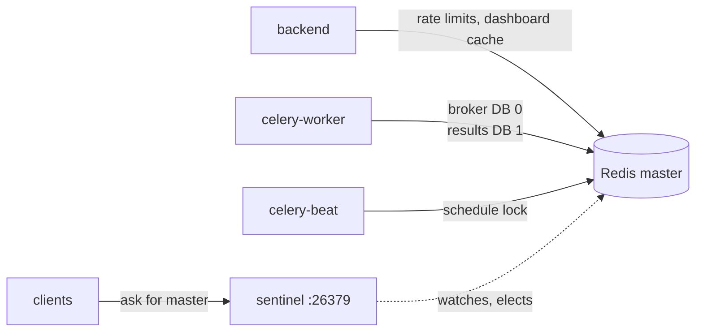
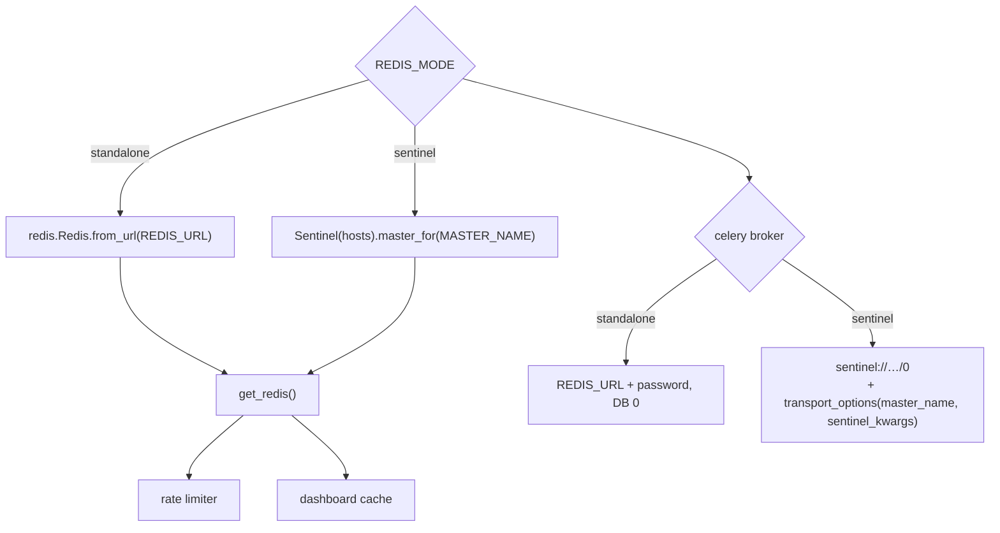
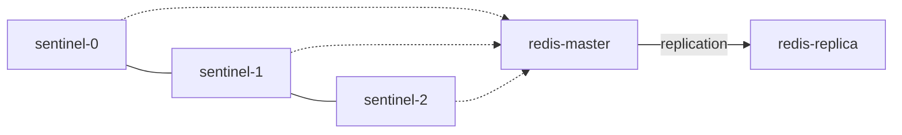

# Redis and Sentinel

What Redis holds, how the app finds the master, and the one configuration mistake that looks
like an outage.

Code: `backend/app/persistence/redis.py` · settings: `REDIS_URL`, `REDIS_MODE`,
`REDIS_SENTINEL_HOSTS`, `REDIS_MASTER_NAME`, `REDIS_PASSWORD` · manifests:
`infra/k8s-dev/40-redis.yaml`, `40b-redis-sentinel.yaml`

---

## 1. What Redis is used for



| Consumer | Key space | Data |
| --- | --- | --- |
| Celery worker | DB 0 | queued tasks (sync, notifications, drafts) |
| Celery worker | DB 1 | task results, with a TTL |
| Celery beat | DB 0 | one beat at a time — the schedule lock |
| API rate limiter | DB 0, `rl:*` | counters with window TTL |
| Overview board | DB 0, `dash:*` | short-lived aggregates, so the board does not query Postgres per panel |

Everything here is **derivable**: losing Redis costs queued background work and a few caches, not
knowledge, conversations or audit history. Those are in Postgres. That is what makes a flush an
acceptable, if noisy, remedy.

---

## 2. Two modes, one interface



### Standalone (dev default)

One master, one sentinel for failover, `REDIS_URL=redis://redis-service:6379/0`. The password is
injected into the URL at runtime if `REDIS_PASSWORD` is set and the URL has none — so an operator
who rotates the password does not have to URL-encode it by hand.

### Sentinel (production)

Three masters' worth of sentinels watch one master and elect a replacement on failure. The
application never hard-codes the master address: it asks Sentinel `SENTINEL get-master-addr-by-name
<master>` and reconnects on `+switch-master`.

Celery needs two extra things, and both are easy to miss:

```python
broker_url = "sentinel://sentinel-0:26379;sentinel://sentinel-1:26379;sentinel://sentinel-2:26379/0"
transport_options = {
    "master_name": "mymaster",
    "sentinel_kwargs": {"password": "<same password>"},   # <-- sentinels have requirepass too
}
```

**The mistake:** kombu and redis-py do **not** send the URL password to Sentinel itself. With
`requirepass` on the sentinel (which any sane deployment has), discovery fails with
`Authentication required` even though `redis-cli -a … -p 6379 ping` works fine. The symptom looks
exactly like "Redis is down" while Redis is perfectly healthy. `transport_options()` exists only
to carry `sentinel_kwargs`.

### Databases are a convention, not a namespace

Broker is DB 0 and results are DB 1, in both modes (standalone rewrites `/0` → `/1`). A task
result written to the broker DB is invisible to the backend reading the result DB — the task runs
and the UI hangs on "pending". If you see that, check the two URLs first.

---

## 3. Failure behaviour

| Failure | What the app does |
| --- | --- |
| master down, sentinel up | clients re-resolve; a few seconds of errors, then recovery |
| sentinel password wrong | every connection fails, Celery never consumes; logs say `Authentication required` |
| Redis fully down | API keeps serving chat (retrieval and LLM do not need it); rate limiting fails open; background jobs queue up nowhere and are lost |
| broker DB flushed while tasks run | workers finish in-flight tasks; results are gone, so the UI shows a completed job as pending |
| memory full (`maxmemory`) | keys evict by policy; a long sync can evict a rate-limit counter (harmless) or a result (annoying) |

The health endpoint reports Redis separately from Postgres and embeddings, so "Redis down" is
never confused with "database down" on the board.

---

## 4. Operations

```bash
# is the master alive and which one is it?
redis-cli -h redis-service -p 6379 -a "$REDIS_PASSWORD" ping
redis-cli -h redis-sentinel-service -p 26379 -a "$REDIS_PASSWORD" \
  SENTINEL get-master-addr-by-name mymaster

# queue depth (broker DB)
redis-cli -h redis-service -n 0 LLEN celery

# what is eating memory
redis-cli -h redis-service -a "$REDIS_PASSWORD" --bigkeys
```

| Task | Guidance |
| --- | --- |
| persistence | AOF `everysec` for the broker; RDB alone loses the last second of queue |
| memory | `maxmemory-policy noeviction` for a pure queue, `allkeys-lru` if the cache shares the instance |
| backups | not required — nothing here is primary data |
| scaling | one master; Sentinel for failover, not throughput |
| upgrade | rolling restart of sentinels first, then the master; clients reconnect |

---

## 5. Fitting it to the cluster

The dev cluster runs one master + one sentinel to keep the footprint small. Production sizing:



Three sentinels (odd number, quorum 2), one master, at least one replica. The application
configuration does not change — only `REDIS_SENTINEL_HOSTS` grows from one entry to three, and
`REDIS_MASTER_NAME` must match the name the sentinels were started with (`mymaster` by default).
