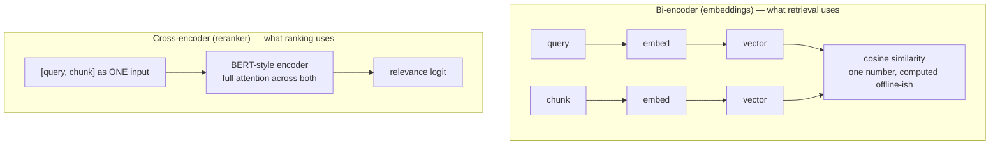
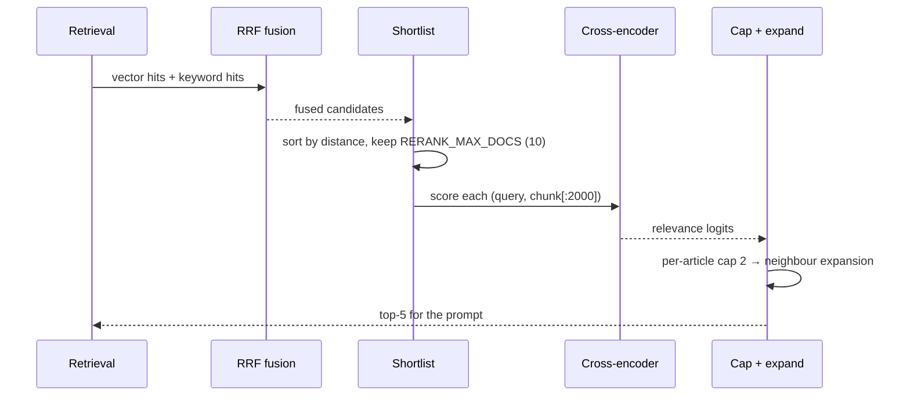
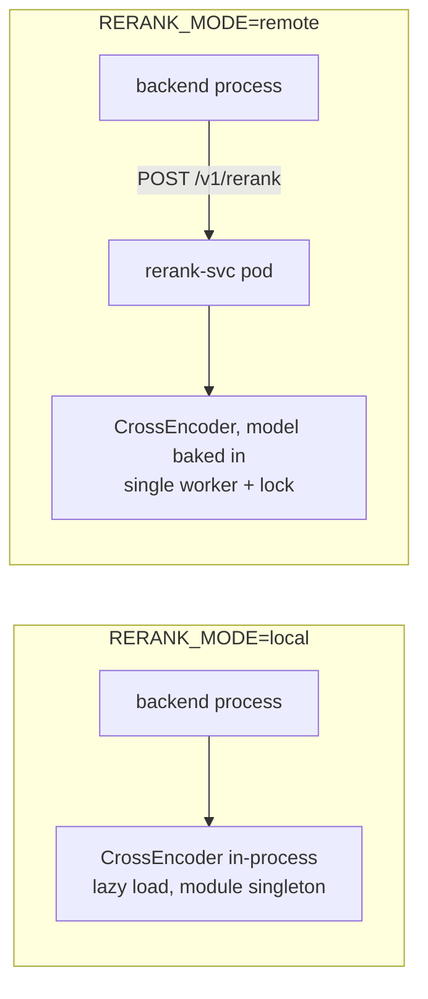

# Reranking — cross-encoder scoring

Why a second ranking stage exists, how it is batched, and why it is allowed to fail.

Code: `backend/app/rag/reranker.py` (client + local model), `services/rerank/app.py` (remote
service) · settings: `RERANK_ENABLED`, `RERANK_MODE`, `RERANK_MODEL`, `RERANK_CANDIDATES`,
`RERANK_MAX_DOCS`, `RERANK_TIMEOUT_S`, `RERANK_DEVICE`

---

## 1. Bi-encoder vs cross-encoder



The bi-encoder embeds query and chunk **separately**, so it can pre-compute every chunk vector
and search millions of rows — but it never sees the two texts together. "About the topic" is all
it can measure.

The cross-encoder puts query and chunk into **one** input and lets attention run across both. It
measures "does this passage answer *this* question", which is a different and much better signal
— at the cost of one forward pass per candidate, so it can only be run on a shortlist.

That is the whole design: **cheap recall first, expensive precision second.**

---

## 2. Where it sits in the pipeline



Two bounds keep the stage affordable:

| Bound | Default | Why |
| --- | --- | --- |
| `RERANK_CANDIDATES` | 8 | how many to pull for reranking when hybrid search is on |
| `RERANK_MAX_DOCS` | 10 | hard cap on pairs scored per question |

Measured on this CPU-only cluster: **20 candidates × 2,000 chars took 27 s per call**, so the
8 s client budget made *every* rerank time out and silently fall back to vector order. The
long tail does not change the top 5 — scoring it only added latency.

---

## 3. Modes



| | local | remote |
| --- | --- | --- |
| latency | no network hop | + in-cluster RTT (negligible) |
| memory | model lives in every backend process (× workers) | model lives in one pod |
| isolation | a heavy question competes with the API | scoring cannot stall request handling |
| scaling | scale the API and you scale the model copies | scale `rerank-svc` independently |
| default | `local` | switch by ConfigMap, no rebuild |

`rerank-svc` contract:

```
POST /v1/rerank  {"query": str, "documents": [str, …]}
              → {"results": [{"index": int, "relevance_score": float}, …], "took_ms": int}
GET  /health      → {"status": "ok", "model": str, "loaded": bool}
```

It loads lazily (a pod that is still loading must not fail its startup probe), scores under a
single lock (torch already saturates the CPU; concurrent batches only make every request slower),
and caps batch size so one pathological request cannot hold the lock for minutes.

---

## 4. From logit to confidence

The reranker returns raw logits, and its scale is model-specific. `bge-reranker-base` emits
logits in a narrow range where `sigmoid` saturates near 0.73 for genuinely relevant pairs — which
made a 0.75 gate almost unreachable even for an exact title match.

The pipeline therefore applies:

```python
sig   = 1 / (1 + exp(-2.5 * logit))        # 2.5× gain restores separation
blend = 0.7 * sig + 0.3 * (1 − distance)   # mostly rerank, some vector signal
```

Guard against mixing: `sigmoid` without the gain compresses everything into 0.5–0.75, and a gate
tuned on that is really a gate on noise.

Two small corrections are applied to the final score:

- **title overlap bonus** — `min(0.15 × matching query terms in the title, 0.45)`,
- **generic-page penalty** — index pages titled `Network`, `Server`, `Database`, `Storage`,
  `Security`, `Start here`, `IT support routing guide` lose 0.1, because they otherwise crowd out
  the specific runbook that actually answers the question.

---

## 5. Failure is a fallback, never an error

```python
try:
    scores = _score(query, docs)
    … rank …
except Exception as exc:
    logger.warning("rerank failed (%s) — falling back to vector order")
    return sorted(docs, key=lambda d: d["distance"])[:top_k]
```

A broken reranker degrades quality; it does not take chat down. The same rule applies to the
remote mode: a timeout, a 500 or an unreachable service all land in that `except`.

That is deliberate, and it is also why the failure is logged at WARNING with the reason — a
silent fallback is how the 27-second timeout above went unnoticed for a release.

---

## 6. Tuning table

| Symptom | Setting | Direction |
| --- | --- | --- |
| answers slow, all fall back to vector order | `RERANK_MAX_DOCS`, `RERANK_TIMEOUT_S` | lower the batch, or raise timeout after measuring |
| answers cite the right article but rank it 3rd | `RERANK_CANDIDATES` | raise slightly (more recall before scoring) |
| generic hub pages dominate | generic penalty | already applied; tighten the title list |
| rerank is pointless (no CPU headroom) | `RERANK_ENABLED=false` | hybrid + RRF still works, quality drops |
| model pod OOMKilled | `rerank-svc` memory limit | `bge-reranker-base` needs ~1–2 GB with torch |
| wrong language | `RERANK_MODEL` | use a multilingual cross-encoder and re-measure |

Model weights are baked into the image (`services/rerank/Dockerfile`), so changing
`RERANK_MODEL` means rebuilding and pushing that image — not a ConfigMap change.
