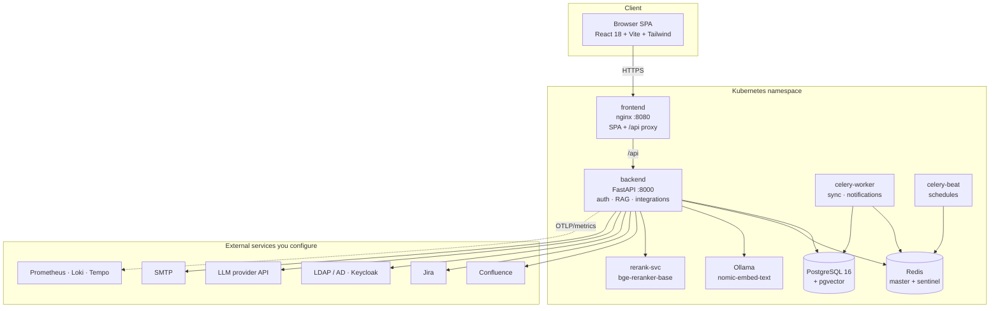
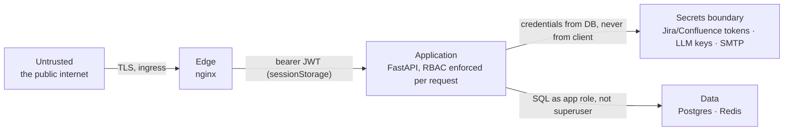
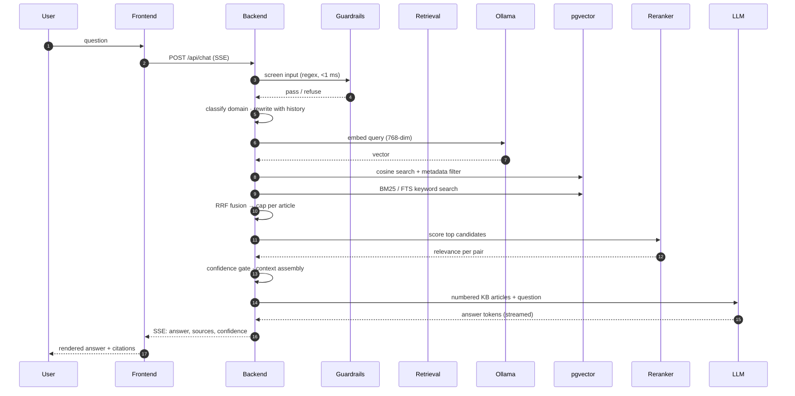
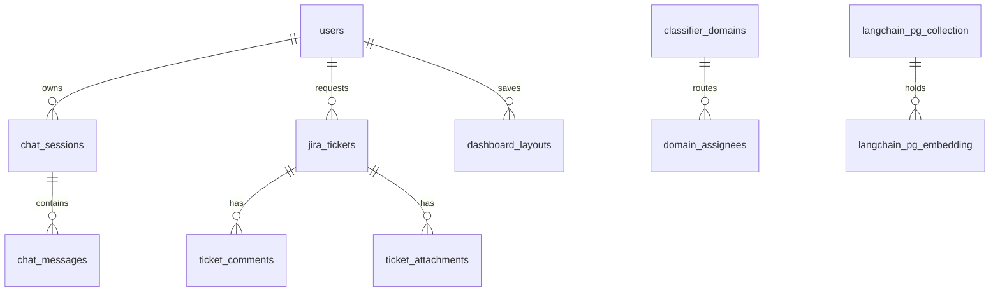
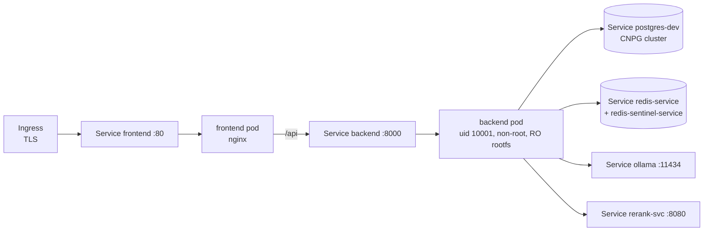

# System architecture

What runs, what talks to what, and where the boundaries are.

---

## 1. Component map

Nine workloads. Two of them (`ollama`, `rerank-svc`) exist only so no model weights are
downloaded at runtime — both images ship their weights, which is what makes an air-gapped
install possible.

---

## 2. Trust boundaries

| Boundary | Rule |
| --- | --- |
| Edge → app | every route except `/health`, `/api/auth/*` and the login page needs a JWT; RBAC is re-checked inside the handler, not just in the router |
| App → secrets | integration credentials are read from the database (or `backend-secrets` at boot); they are never sent to the client and never appear in logs |
| App → data | the Postgres role is not a superuser; `CREATE EXTENSION vector` is the single privileged step, done once by CNPG |
| App → external | outbound only. Nothing external calls into the cluster. |

The frontend holds the access token in `sessionStorage` and sends it as `Authorization:
Bearer`. There is no cookie-based session, so a CSRF token is not needed and a stolen tab does
not survive a browser restart.

---

## 3. One question, end to end

Every stage degrades instead of failing: a broken reranker falls back to vector order, a
failed keyword search falls back to SQL full-text, a failed domain filter retries unrestricted.
The only hard failure is "no LLM configured", which is reported as such.

---

## 4. Data model, in one picture

| Store | Contents |
| --- | --- |
| `langchain_pg_collection` / `langchain_pg_embedding` | KB chunks, their embeddings and metadata (`page_id`, `chunk_index`, `domain`, `source_url`) |
| `chat_sessions` / `chat_messages` | conversations, confidence, citations, feedback |
| `jira_tickets` / `ticket_comments` / `ticket_attachments` | the mirrored queue |
| `users`, `user_permission_overrides`, `rbac_matrix` | identity and capability |
| `system_settings` | integrations, AI service, branding, security |
| `audit_log` | who did what, including refusals |
| `runtime_kv` | small runtime knobs and the saved dashboard board |
| `checkpoints*` | LangGraph state for multi-step flows |

Details: [VECTOR-STORE.md](VECTOR-STORE.md).

---

## 5. Deployment topology

- Backend runs as a non-root user with a read-only root filesystem; only `/tmp` is writable.
- Postgres is a CNPG `Cluster` with a 5 Gi volume in dev and nightly `ScheduledBackup`.
- Redis is one master plus one sentinel in dev; production scales to three of each without a
  code change (see [REDIS.md](REDIS.md)).
- SSE is why the ingress carries long timeouts and buffering off — a buffered stream makes
  answers arrive in one chunk at the end.

---

## 6. Why these parts exist

| Component | The problem it solves | Cost |
| --- | --- | --- |
| pgvector | one database for content, chat, audit — no second system to back up or secure | index lives next to the data it filters |
| BM25 + vector + RRF | embeddings miss exact identifiers (`KB-1042`, `CrashLoopBackOff`); keywords miss paraphrase | one extra query per turn |
| cross-encoder | cosine similarity ranks "about the topic"; a cross-encoder ranks "answers the question" | 0.2–3 s depending on batch and node |
| confidence gate | an answer built on weak retrieval should say so | a threshold to tune |
| Ollama locally | embeddings never leave the cluster, no per-token cost | CPU time, one pod |
| rerank-svc | the reranker is memory-hungry and must not compete with the API process | one more pod |

---

## 7. What this design deliberately does not do

- **No agent autonomy over infrastructure.** The assistant reads state; changes are proposed as
  tickets or approvals, not executed.
- **No silent retries against the LLM provider.** A failed call surfaces as an error with a
  retry control; masked retries make cost and latency impossible to explain.
- **No second source of truth for knowledge.** Confluence is the source; the vector store is a
  derived index that can be rebuilt from scratch.
- **No client-side authorization.** The SPA hides what a role cannot use, and the API enforces
  it again — hiding a button is not a permission.
