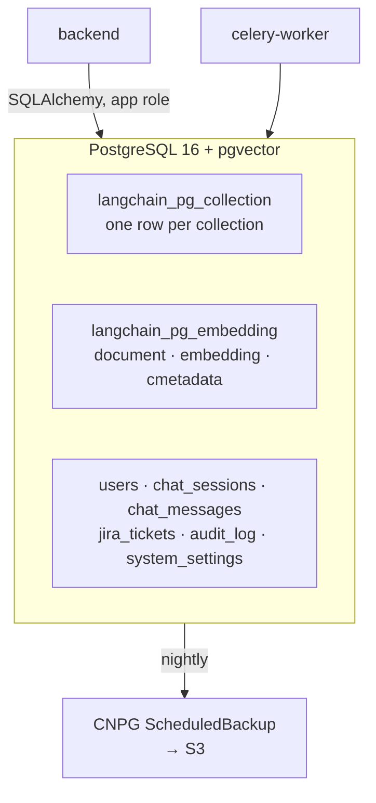
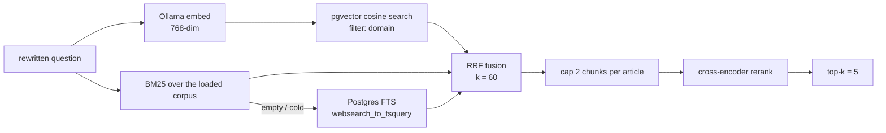
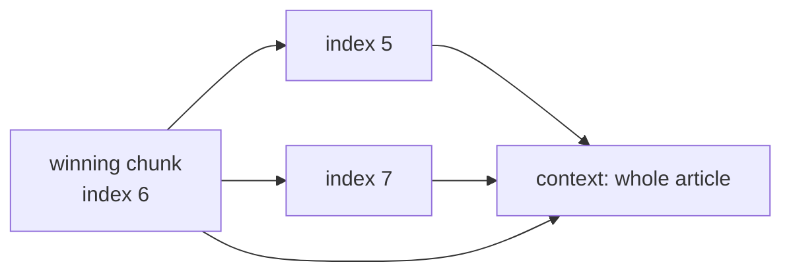

# Vector store — PostgreSQL + pgvector

Why the knowledge base, the chat history and the audit trail live in one database, and how the
vector index and the keyword index cooperate.

Code: `backend/app/rag/retrieval.py`, `backend/app/rag/bm25_index.py` · manifest:
`infra/k8s-dev/20-database.yaml` · settings: `DATABASE_URL`, `RETRIEVAL_TOP_K`, `HYBRID_*`

---

## 1. One database, three jobs



The alternative — a dedicated vector database next to Postgres — buys a second backup policy, a
second auth story and a second failure mode. At this size (tens of thousands of chunks) pgvector
answers in milliseconds inside the database that already holds the RBAC, the audit trail and the
source metadata. A join between a chunk and the user who may read it is a `WHERE` clause, not a
network hop.

---

## 2. The two tables

LangChain's `PGVector` wrapper owns the schema:

| Table | Columns that matter |
| --- | --- |
| `langchain_pg_collection` | `uuid`, `name` (`it_help_chatbot_kb`) |
| `langchain_pg_embedding` | `uuid`, `collection_id`, `embedding vector(768)`, `document text`, `cmetadata jsonb`, `tsv tsvector` |

`cmetadata` is the part that makes retrieval selective:

```json
{
  "page_id": "123456",
  "chunk_index": "7",
  "page_title": "Kubernetes & Cloud Workloads",
  "domain": "kubernetes",
  "source_url": "https://site.atlassian.net/wiki/spaces/HELP/pages/123456"
}
```

| Key | Read by |
| --- | --- |
| `page_id` | per-article cap, neighbour expansion, RBAC join |
| `chunk_index` | ordering a page's chunks when expanding neighbours |
| `domain` | classifier filter, RBAC scoping |
| `source_url` | the citation link |
| `page_title` | citation label and the chunk's context prefix |

Metadata is queried as JSONB (`cmetadata->>'page_id'`), and neighbour expansion pulls a whole
article with `ORDER BY (cmetadata->>'chunk_index')::int` — no extra table, no join table to keep
in sync.

### The extension

`CREATE EXTENSION vector` needs superuser. `20-database.yaml` runs it once through CNPG's
`postInitApplicationSQL`, so a fresh install is unattended; on external Postgres it is one
statement. The application role is deliberately **not** a superuser.

---

## 3. Two searches, one ranking



**Vector search** finds paraphrase. It does not find `KB-1042`, `CrashLoopBackOff` or `Ora-01555`
reliably — those tokens have no useful neighbourhood.

**BM25** finds those exactly: an in-memory Okapi index over chunk text (term saturation + length
normalisation), sub-millisecond, rebuilt when the corpus changes. If it is cold or empty, the
query falls back to PostgreSQL full-text (`websearch_to_tsquery`), and if that returns nothing, a
plain `ILIKE` over terms — a deliberately blunt last resort that still beats returning nothing.

**RRF** (`1 / (60 + rank)`) merges the two lists without needing their scores to be comparable.
A document found by either method lands near the top; a document found by both wins.

**Per-article cap (2)** exists because of a measured failure: for *"What is the world of Web"*,
four of five slots were chunks of the same article, so the model effectively saw one document
and answered narrowly while citing five "sources".

---

## 4. Neighbour expansion

A chunk is a slice. After the cap picks winners, the pipeline fetches the chunks at
`chunk_index ± 1` from the same `page_id` (bounded to ~9,000 characters) so the model reads a
whole article instead of a fragment.



Neighbours are marked `expanded: true` and inherit the seed's distance, so they can never
outrank the chunk that earned the slot — expansion adds context, it does not change the ranking.

---

## 5. Capacity and operations

| Question | Answer |
| --- | --- |
| how much data? | a 10k-page wiki at ~8 chunks/page ≈ 80k rows × (768 floats + text) ≈ 1–2 GB |
| is there an ANN index? | not by default. At this size a sequential cosine scan is milliseconds; add `ivfflat`/`hnsw` when p95 retrieval exceeds your budget, and remember it needs `ANALYZE` and tuning |
| backups | CNPG `ScheduledBackup` nightly to S3; the KB is derived and can be rebuilt from Confluence, chat/audit cannot |
| vacuum | chunk deletes happen on every re-sync of a changed page; default autovacuum is adequate |
| read replicas | not needed for this workload; the app is write-light after a sync |

**Rebuild vs restore.** Knowledge can always be rebuilt (`Sync`). Conversations, audit rows and
the ticket mirror cannot — that is the data worth testing a restore on
([postgres-backup-restore.md](../postgres-backup-restore.md)).

---

## 6. Failure modes

| Symptom | Cause | Check |
| --- | --- | --- |
| retrieval returns nothing at all | empty collection / failed sync | `SELECT count(*) FROM langchain_pg_embedding` |
| `relation "langchain_pg_embedding" does not exist` | schema not migrated | `job/db-init` status |
| `type "vector" does not exist` | extension missing | `CREATE EXTENSION vector` as superuser |
| keyword search silently useless | BM25 index not built and FTS column absent | pipeline log line `keyword search skipped` |
| answers degrade after a big sync | mixed chunk sizes or two embedding models | re-index from an empty collection |
| slow queries under load | missing ANN index at very large corpus | `EXPLAIN ANALYZE` the similarity query |
