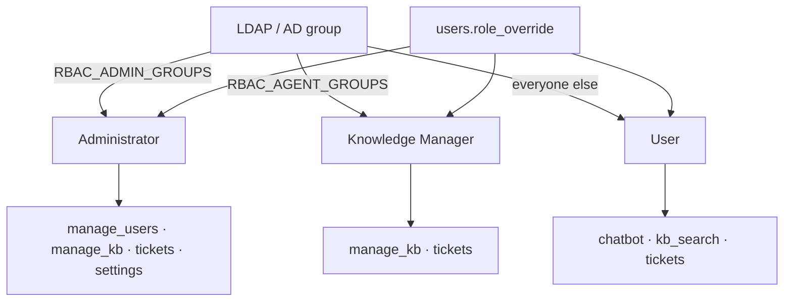
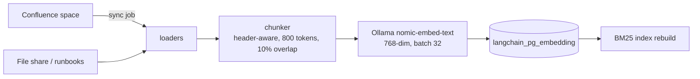

# Administrator guide

Day-2 ownership of the platform: who can do what, how knowledge gets in, how integrations are
wired, and how to prove what happened.

**Roles covered:** Administrator, Knowledge Manager (domain owner), and the per-user
capability overrides that sit on top.

---

## 1. Roles and permissions

Three roles, five capabilities. A role is a starting point; an administrator can override an
individual account.

| Capability | User | Knowledge Manager | Administrator |
| --- | --- | --- | --- |
| `chatbot` — use chat | ✓ | ✓ | ✓ |
| `kb_search` — search the KB directly | ✓ | ✓ | ✓ |
| `create_tickets` | ✓ | ✓ | ✓ |
| `manage_kb` — knowledge + routing domains | — | ✓ | ✓ |
| `manage_users` — users, roles, overrides | — | — | ✓ |

Where it lives: `backend/app/auth/rbac.py` (group → role), `role_domains`
(`user=general,system; knowledge=*; admin=*`) for which domains a role may read, and
**Users → Permissions** for per-account capability toggles.

**Domain scoping is an ACL, not a hint.** A `user` sees `general` and `system` content only;
their search is filtered before ranking, and the chat refuses to cite what they cannot read.

---

## 2. Domains and routing

A **domain** is a topic bucket (`database`, `network`, `security`, `system`, `general`). It
does three things:

1. **Scopes retrieval** — the classifier guesses a domain and the vector search filters on it.
   If the scoped search looks weak the pipeline retries unrestricted and keeps the better
   result, so a misclassification costs recall, never a wrong answer.
2. **Routes tickets** — `DOMAIN_JIRA_ROUTING` maps a domain to a project/assignee.
3. **Decides who can read it** — via `role_domains` and per-domain assignees.

Manage them on **Knowledge → Domains**: rename, describe, attach keywords, and pick assignees
(the people a ticket in that domain can be assigned to). A domain with no assignee cannot
route a ticket; the create dialog says so instead of failing at submit.

---

## 3. Knowledge: how content gets in

**Knowledge → Sync** pulls the configured Confluence spaces (and the optional file-share
directory), chunks each page, embeds it, and upserts into pgvector. It is incremental: pages
that moved or were deleted upstream are pruned in the same run, so the base does not accumulate
ghosts.

| Action | What it does | When to use |
| --- | --- | --- |
| **Sync** | full incremental pull + prune | after Confluence edits, or on a schedule |
| **Reclassify** | re-runs the domain classifier over stored chunks | after changing domains or keywords |
| **Recent / Sources** | what was indexed, from where | to prove a page made it in |

Sync status is on the Knowledge page and in `GET /api/sync-status`. Chunking details and the
reasoning behind 800 tokens: [../architecture/CHUNKING.md](../architecture/CHUNKING.md).

---

## 4. Integrations

**Settings → Integrations.** Every connector has a **Test** button that performs a real
authenticated call; a saved form is not evidence that the connector works.

### Confluence

| Field | Notes |
| --- | --- |
| Base URL | `https://<site>.atlassian.net/wiki` |
| Email + API token | the token is stored encrypted and never returned |
| Space keys | comma-separated; only these spaces are indexed |

### Jira

| Field | Notes |
| --- | --- |
| Base URL / email / token | same account as Confluence is fine |
| Project key | e.g. `ITHD`; tickets are created here |
| Service desk ID + request types | optional; enables portal-style requests per domain |

Writes are one-way by design: the app transitions and comments on issues, and mirrors them into
the queue. **Tickets → Sync Jira** reconciles the mirror with upstream state.

### Keycloak / OIDC

Issuer, realm, client id, client secret, redirect URI. Once saved, the login page offers SSO.
Group claims feed the same role mapping as LDAP.

### LDAP / AD

Bind DN + password, base DN, user filter (`(sAMAccountName={u})` for AD, `(uid={u})` for
OpenLDAP). Service bind only — user passwords are never stored.

### Email & notifications

SMTP host/port/user/password and the from-address. Used for escalation notice emails and
password/MFA messaging. **Do not hard-code a mail domain** — it is a setting so the same build
works for any tenant.

---

## 5. AI service

**Settings → AI service** chooses the answer model: provider, base URL, model name, API key,
max tokens, and the optional local fallback (`llama3.2:3b` via Ollama) used when the provider
errors.

- The key is encrypted at rest and never returned by `GET /api/settings`.
- Changing the model changes answers immediately; no redeploy.
- Retrieval is independent of this choice — embeddings always come from Ollama, so switching
  the chat model never invalidates the index.
- Cost, tokens and p95 latency for the selected window are on the **Overview** board. The same
  panels appear for every role: administrators see platform-wide spend, everyone else sees
  their own (`scope: "self"`), so no one is told they are looking at the organization's bill.

---

## 6. Guardrails

Deterministic checks run **before** any model call (sub-millisecond, no LLM in the loop):

| Category | Example trigger |
| --- | --- |
| Personal / secret data | card numbers, API keys, private keys, national IDs |
| Prompt injection | "ignore previous instructions", role-play overrides |
| Prompt overflow | input beyond the configured limit |
| Profanity | configured lexicon |
| Toxicity / abuse | directed abuse patterns |

A refusal is shown to the user as *Blocked by content policy* and recorded in `audit_log`
**without** the sensitive value. Every event is counted on the Overview board under
**Guardrail events** (admin only). Tuning usually means narrowing a pattern, not disabling a
category — the spec is [../architecture/security-guardrails-spec.md](../architecture/security-guardrails-spec.md)
and the code is `backend/app/security/guardrails.py`.

---

## 7. Tickets and approvals

- **Tickets** is the queue: filters, sort, CSV export, and an **Edit** modal per ticket
  (Details for fields, Activity for the timeline and notes).
- Internal notes are agent-only: they are posted to Jira with a role-restricted comment, so
  the requester never sees them. Public replies go to the customer.
- **Approvals** holds requests that need a second pair of eyes before they run.
- Saving a ticket pushes status, fields and comments to Jira in one operation and mirrors the
  result locally; if Jira refuses, the UI says which part failed instead of reporting success.

---

## 8. Audit, observability, health

| Surface | Content |
| --- | --- |
| **Audit log** | who did what, when — sign-ins, settings changes, KB syncs, refusals, ticket writes. Exportable. |
| **Conversations** | every session with its messages, confidence and citations; export as transcript |
| **Overview** | KPIs, cost, latency, guardrail events, dependency health. **Edit layout** turns the board into a Grafana-style grid: drag a panel by its handle, resize it from any edge, then **Save view** — the arrangement is stored per account in `runtime_kv` (`board_layout:<user>`) and restored on every device. Below 1024 px the board stacks into one column. |
| **`GET /api/health`** | dependency probe: Postgres, Redis, embeddings, vector store, LLM |
| **`GET /api/setup/readiness`** | which integration is unconfigured, for a fresh install |

Metrics and traces: `infra/monitoring/` (Alloy → Prometheus/Loki) and
[../monitoring.md](../monitoring.md).

---

## 9. Users

**Users** lists directory accounts on first sign-in (no pre-provisioning). Per account you can:

- change the **role** (User / Knowledge Manager / Administrator),
- toggle **capabilities** (chat, KB search, tickets, manage KB, manage users),
- disable an account (`status`), which blocks new tokens without deleting history.

Group membership in the directory always wins on the next sign-in unless an explicit override
is set — record why an override exists in the audit trail by making the change through the UI,
not SQL.

---

## 10. Routine maintenance

| Cadence | Task |
| --- | --- |
| daily | glance at Overview: error rate, guardrail spikes, dependency health |
| weekly | Knowledge → Sync; review conversations marked *not helpful* |
| monthly | audit log export; review disabled accounts; check backup restore drill |
| per release | image tags in `infra/env`, `deploy.sh`, then the smoke test in SETUP §7 |
| on incident | [../OPERATIONS.md](../OPERATIONS.md) runbooks |
