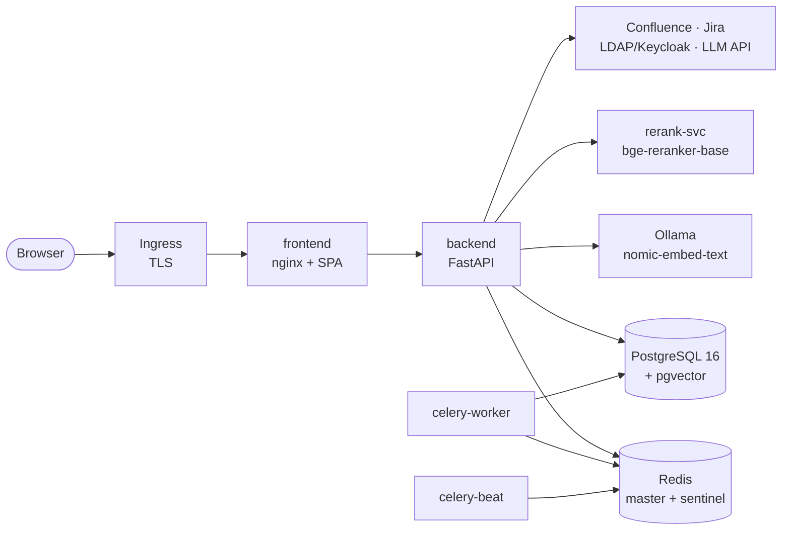

# Operation setup guide

How to stand this stack up from nothing: a filled-in `infra/env`, four secrets, four images,
twelve manifests, and a checklist that tells you it worked.

**Audience:** whoever owns the cluster. Everything here is idempotent — re-running a step is
safe, and the scripts refuse to continue when a prerequisite is missing rather than half
deploying.

---

## 1. What you are installing



Nine workloads in one namespace. No external state is required beyond an S3 bucket if you
enable database backups.

| Component | Image | Why it exists |
| --- | --- | --- |
| `frontend` | `.../frontend:<FRONTEND_TAG>` | nginx serving the built SPA and proxying `/api` |
| `backend` | `.../backend:<BACKEND_TAG>` | the FastAPI app: auth, RAG, integrations, API |
| `celery-worker` | same as backend | background jobs (sync, notifications, drafts) |
| `celery-beat` | same as backend | scheduled jobs (nightly KB sync, reconciliation) |
| `postgres-dev` | CNPG `Cluster` | knowledge chunks, chat, audit, settings, tickets |
| `redis` + `redis-sentinel` | `redis:7.4` | cache, Celery broker/result backend, rate limits |
| `ollama` | `.../ollama:0.5.7-models` | embeddings only; the model is baked into the image |
| `rerank-svc` | `.../rerank:<RERANK_TAG>` | cross-encoder scoring, CPU, model baked in |
| `alloy` | Grafana Alloy | ships metrics/logs to Prometheus/Loki (optional) |

---

## 2. Prerequisites

| Need | Detail |
| --- | --- |
| Kubernetes | 1.27+; the dev cluster runs single-node k3s |
| CNPG operator | CloudNativePG installed cluster-wide (the `Cluster` CRD must exist) |
| StorageClass | one that supports `ReadWriteOnce`, named in `infra/env` as `STORAGE_CLASS` |
| IngressClass | `ingressClassName` in `infra/env`; TLS via cert-manager or a manual secret |
| Registry | push access to `REGISTRY`, e.g. `harbor.example.com/rag-chatbot-dev` |
| DNS | `DOMAIN` resolves to your ingress |
| Outbound | Confluence, Jira, your LDAP/AD, and the LLM provider (unless air-gapped) |

Air-gapped clusters are supported: the embedding model and the reranker weights are inside the
images, so no model download happens at runtime. Only the LLM provider call leaves the cluster.

---

## 3. Configure

```bash
cp infra/env.example infra/env
$EDITOR infra/env
```

| Key | Meaning |
| --- | --- |
| `NAMESPACE` | target namespace (`rag-chatbot-dev`) |
| `REGISTRY` | image registry prefix |
| `DOMAIN` | public host, e.g. `dev-chat.example.com` |
| `STORAGE_CLASS` | PVC class for Postgres and Redis |
| `INGRESS_CLASS` | ingress controller class |
| `TLS_SECRET` | secret holding `tls.crt` / `tls.key` |
| `BACKEND_TAG` / `FRONTEND_TAG` / `RERANK_TAG` | image tags to deploy |
| `OLLAMA_MODEL` | `nomic-embed-text` (must match `EMBEDDING_MODEL`) |
| `REDIS_PASSWORD` | also written into `backend-secrets` |

Pipeline knobs (chunk size, top-k, rerank batch, gate threshold) live in
`infra/k8s-dev/05-config.yaml`, not in `infra/env`. Values are read at request time where it
matters, so a ConfigMap change plus a backend rollout is enough — no rebuild.

---

## 4. Secrets

```bash
infra/scripts/create-secrets.sh
```

Creates, once, in the namespace:

| Secret | Keys |
| --- | --- |
| `backend-secrets` | `DATABASE_URL`, `REDIS_URL`, `REDIS_PASSWORD`, `JWT_SECRET`, `LDAP_BIND_PASSWORD`, `rerank-api-key` |
| `postgres-dev-app` | `username`, `password` (CNPG bootstrap) |
| `cnpg-backup-s3` | `ACCESS_KEY_ID`, `SECRET_ACCESS_KEY`, `REGION` — only if backups are on |
| `<TLS_SECRET>` | `tls.crt`, `tls.key` |

**Not here:** Confluence/Jira tokens, LLM API keys, SMTP passwords, Keycloak client secrets.
Those are written through **Settings → Integrations** and stored in the database, encrypted by
the application. They are never returned by the API and never rendered back into a form.

`JWT_SECRET` must not be empty. If it is, the backend refuses to issue tokens (by design —
a blank HMAC key means every token is forgeable); on first boot the app generates one and
keeps it in `system_settings.security`.

---

## 5. Images

```bash
infra/scripts/build-images.sh          # builds backend, frontend, rerank
```

The Ollama image is built once per model change:

```bash
docker build -t $REGISTRY/ollama:0.5.7-models infra/images/ollama
docker push  $REGISTRY/ollama:0.5.7-models
```

`build-images.sh` tags with the values from `infra/env`, so the tag you build is the tag you
deploy. Bump `frontend/package.json` version when the UI changes — the API reports it.

---

## 6. Deploy

```bash
infra/scripts/deploy.sh
```

It renders `infra/k8s-dev/*.yaml` into `infra/.rendered/` with your `infra/env` values, then
applies in dependency order and waits:

```
namespace → config → postgres (Ready) → db-init (Complete)
        → redis / ollama / rerank / celery → backend (Ready) → frontend (Ready)
        → backup, monitoring
```

Applying the manifests by hand also works (that is what the dev cluster runs), but the scripts
are what check for the CNPG CRD, the StorageClass, the IngressClass and the secrets first.

### The one privileged step

`CREATE EXTENSION vector` needs superuser. `20-database.yaml` runs it once through CNPG's
`postInitApplicationSQL`, so an unattended install works. On an external Postgres:

```sql
CREATE EXTENSION IF NOT EXISTS vector;
```

---

## 7. First-boot checklist

```bash
kubectl -n $NAMESPACE get pods                 # every pod 1/1 Running
kubectl -n $NAMESPACE get job db-init          # COMPLETIONS 1/1
curl -s https://$DOMAIN/api/health             # {"status":"ok", ...}
```

Then, in the UI:

1. **Sign in** with an LDAP/AD or Keycloak account. The first admin is chosen by
   `RBAC_ADMIN_GROUPS` (`it-help-admins` by default) — put yourself in that group, or set
   `DEV_ADMIN_USERNAMES` for a single named account.
2. **Settings → Integrations** → Confluence: base URL, email, API token, space keys.
   → Jira: base URL, email, token, project key.
   → AI service: provider, model, API key. Press **Test** on each; a green result is a real
   round-trip, not a saved form.
3. **Knowledge → Sync** and wait for the run to finish. Chunks appear in
   `langchain_pg_embedding`; the Overview board shows the article count.
4. Ask a question the KB should answer and confirm citations resolve to real Confluence pages.

If retrieval returns nothing, `GET /api/setup/readiness` reports which dependency is
unconfigured (embeddings, vector store, LLM, Confluence, Jira) before you go hunting logs.

---

## 8. Upgrades and rollback

```bash
# bump tags in infra/env, then:
infra/scripts/build-images.sh
infra/scripts/deploy.sh

# rollback: point the tag back and re-apply
kubectl -n $NAMESPACE rollout undo deploy/backend
```

Database migrations run inside `db-init` (`python -m app.bootstrap --init`), which is
idempotent. A rollback of the image does not undo a schema change — keep a backup before a
release that touches models (`21-backup.yaml` schedules one nightly; take a manual one with
`kubectl cnpg backup`).

---

## 9. Where to look when it breaks

| Symptom | First place |
| --- | --- |
| 502 from the ingress | `kubectl -n $NAMESPACE logs deploy/frontend` (nginx proxy target) |
| login loops back to the sign-in screen | backend log for `JWT` / `LDAP`; check `JWT_SECRET` is set |
| "No specific guide found" for everything | embeddings: `curl http://ollama:11434/api/tags`, then Knowledge → Sync |
| answers are slow (>10 s) | `architecture/RERANKING.md` — check candidate batch and mode |
| Redis reported down while `redis-cli ping` works | password path — see `architecture/REDIS.md` |
| tickets not appearing | Settings → Integrations → Jira *Test*, then Tickets → **Sync Jira** |

Full runbooks: [OPERATIONS.md](../OPERATIONS.md) and [monitoring.md](../monitoring.md).
