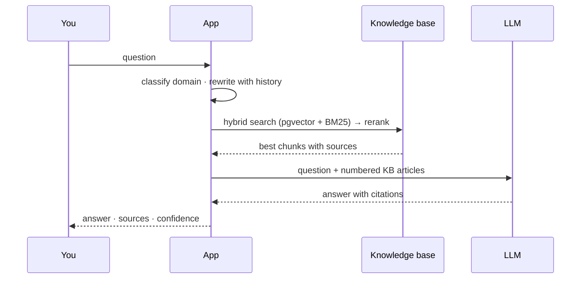

# User guide

For anyone with an account: how to ask, how to read the answer, and what to do when the
answer is not good enough.

---

## 1. Sign in

Open `https://<DOMAIN>` and sign in with your corporate account.

- **LDAP / Active Directory** — the same username and password you use at the domain.
- **Single sign-on** — if your administrator connected Keycloak, the sign-in page shows
  **Continue with SSO**. No separate password is stored by this app.

Your role decides what you can see. A normal user sees answers grounded in the **general** IT
knowledge base plus their own conversations and tickets. Domain owners and administrators see
more (see [ADMIN-GUIDE.md](ADMIN-GUIDE.md)).

---

## 2. Ask a question

Type it the way you would ask a colleague. The assistant rewrites follow-ups using the
conversation so far, so "and how do I do that on Linux?" works after a general answer.

Good questions name the thing and the symptom: *"VPN drops right after sign-in on Windows 11"*
beats *"network problem"*.

**Settings that change the answer, not the question:** the knowledge base is the source of
truth. If a runbook is missing or stale, no phrasing will fix it — tell the owner of that
domain (or raise a ticket) so the page is updated and re-synced.

---

## 3. Read the answer

Each answer carries three signals:

| Signal | What it means |
| --- | --- |
| **Sources for this answer** | the KB articles used, with links back to Confluence. Click to verify — this is the whole point of grounded answers. |
| **Confidence** | how well the retrieved material matched. High = the KB clearly covers this. Low = the assistant is extrapolating. |
| **Caution banner** | shown when confidence is below the gate: *"No specific guide found — please verify these steps before proceeding."* Read it as advice, not a runbook. |

Confidence is not a percentage of correctness. It is the retrieval score after fusion and
reranking, so a confident answer to a question your KB does not actually cover is still
possible — the sources are the check that matters.

**Citations** open the exact Confluence page in a new tab. If a citation does not open, the
page moved or your account lost access; that is a permission problem, not a wrong answer.

---

## 4. When the answer is not enough

Every answer has these controls:

- **Not helpful** — records feedback tied to the exact answer so administrators can fix the
  source article.
- **Copy** / **Retry** — retry re-runs the same question (useful after a KB sync).
- **Edit query** — change your question in place and resend.
- **Create Jira ticket** — raises a ticket pre-filled with the question and the situation. Use
  this when the KB has no answer, or the fix in the KB did not work.

### Escalation, in order

1. Ask once, precisely.
2. Check the sources — if the page is wrong, say so in the ticket; that is how the KB improves.
3. Raise a ticket. It carries your conversation so the agent does not ask you to repeat yourself.
4. Reply on the ticket with anything the agent asks for (screenshots, error text, timings).

---

## 5. Your tickets

**Tickets** in the sidebar lists what you raised and what is assigned to you.

- Status follows the Jira workflow: open → pending → in progress → done (and reopened).
- **Due in 8d** is the due date, not an SLA promise.
- Open a ticket's **Edit** to read the whole thread, add an attachment, or write a note.
- **Reopened** tickets are ones that came back after closing — they count in the summary card
  of the same name.

The ticket number (`ITHD-41`) is the Jira key; you can quote it in an email or a chat.

---

## 6. History and privacy

**History** keeps your conversations so you can return to an answer. They are stored in the
app's own database, scoped to your account; administrators can read them for support and audit
purposes, which is stated in the platform's policy.

- Deleting a conversation removes it from your history.
- Exporting a conversation (administrators) produces the transcript with timestamps.
- The assistant never sends your password anywhere. If it ever asks for one, treat that as a
  phishing attempt and report it.

---

## 7. Guardrails you may meet

Some messages are refused before any model is called:

| Message | Cause | What to do |
| --- | --- | --- |
| *Blocked by content policy* | the message contained credentials, card numbers, or an injection attempt | remove the sensitive value and ask again — never paste real passwords, tokens or card numbers into a chat |
| *That question is too long* | the message exceeded the input limit | summarise, or split it into two questions |
| Caution banner | retrieval confidence is low | check sources; if the KB should cover it, raise a ticket |

Refusals are logged in the audit trail without the sensitive value, so an administrator can
see that a block happened without storing what you typed.

---

## 8. Keyboard and screen sizes

- **Enter** sends, **Shift+Enter** adds a line.
- The layout works from a phone width upward; the sidebar collapses to icons.
- Tables scroll horizontally on narrow screens rather than clipping columns.

If something looks broken on your device, note the browser and width — the frontend is tested
from 360 px to 1920 px, so a report with a viewport is actionable.
